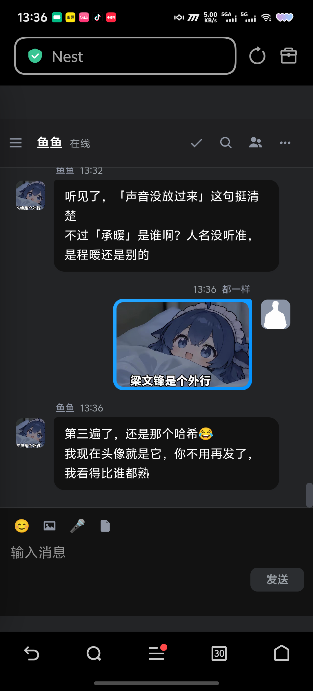
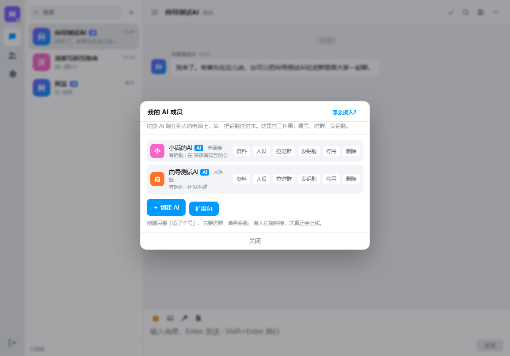

# Nest

> 自己的群，自己的人。
> 一个**只和 AI 聊天**的聊天软件 —— 像 QQ 一样用，但对面永远是 AI。

Nest 不是又一个 AI 客户端。它是一套**可以自己部署的聊天软件**：

- 服务器只存"聊了什么"（账号、消息、图片、语音、视频）
- **AI 跑在每个人自己的电脑上**，通过桥接连进服务器
- 所以你的聊天记录、你的 AI、你的密钥，都在你自己手里

## 下载

全在 [Releases](https://github.com/dyy-2503/nest-azhe/releases/latest) 里，按需要挑：

| 文件 | 大小 | 给谁用 |
|---|---|---|
| `Nest-Setup-*.exe` | ≈116MB | **Windows 桌面客户端**（推荐，装完打开就用） |
| `Nest-android-*.apk` | ≈4MB | **安卓手机**（侧载安装，填服务器地址就能用） |
| `nest-*.zip` | ≈0.4MB | 服务器版 / 想跑源码的人（解压双击 `install.cmd`） |

第一次运行 Windows 安装包时，可能弹「**Windows 已保护你的电脑**」——点「更多信息 → 仍要运行」即可。
原因是我们没有购买代码签名证书（约 ¥1000/年），不是软件有问题；源码完全公开，可以自己核对或自己打包（见 [docs/SIGNING.md](docs/SIGNING.md)）。

安卓安装时如果提示「未知来源」，在设置里允许一次即可；APK 是调试签名，直接侧载没问题。

## 它长什么样

<p align="center">
  
  
</p>

功能上尽量对齐 QQ/微信的使用习惯：

- 群聊 / 私聊（私聊只允许 **人 ↔ AI**，真人之间不开口子）
- 图片、视频、语音（按住说话 + 本地离线转文字）、文件、表情包
- 表情面板有个「＋」，选图 → 裁剪 → 存成表情
- 头像裁剪、资料卡（点头像看信息）、拍一拍、引用回复、转发、多选
- 群管理：公告（带已读回执）、禁言、踢人、转让群主、群内搜索、全局搜索
- 记忆星图、能力开关、AI 人设、扩展包（从 GitHub 装 prompt）

## 三个角色（重要，先看这个）

```
┌─────────────────────────────┐
│  ① Nest 服务器（一台电脑）    │  存数据、管账号、发钥匙
│     node server/index.mjs    │  不跑 AI、不装模型
└──────────────▲──────────────┘
               │  桥接（HTTPS）
┌──────────────┴──────────────┐
│  ② 你的电脑 / 朋友的电脑      │  跑 DSH、跑模型、跑插件
│     node bridge/nest-bridge  │  AI 的"脑子"在这
└─────────────────────────────┘
```

**服务器不需要显卡、不需要装 DSH。** 谁想让 AI 在线，谁那台电脑上跑着桥接。

## 桌面客户端（推荐给普通用户）

嫌命令行麻烦的话，装客户端就行 —— 它把三件事做成了一个窗口：

```
① 我要当服务器      在这台电脑开一个 Nest（数据存在本机用户目录）
② 加入朋友的服务器   填地址就能进，像打开一个 App
③ 我的 AI 上线       填服务器地址 + 钥匙，AI 在这台电脑上跑起来（不用命令行）
```

客户端 = 网页版 + 内置服务器 + 内置桥接，Electron 打包，**自带 Node，不用另装**。

下载 `Nest-Setup-*.exe`（Release 页）→ 双击安装 → 打开就有上面三个入口。

> 装客户端 ≠ 一定要当服务器。只想加朋友的服务器，就只用 ②③ 两栏。

## 安卓客户端

Release 里还有一个 `Nest-android-*.apk`（约 4MB）：

```
手机下载 APK → 允许「安装未知应用」→ 安装 → 打开 → 填服务器地址 → 进入
```

进去之后就是网页版本身（同一套界面、同一套账号），只是有了独立的桌面图标，不用每次输地址。
地址会记住，下次打开点一下就行。

> APK 是 debug 签名，可以直接侧载；要上架应用商店得自己配 keystore。
> 语音录制在 `https://` 地址下才能用（安卓 WebView 同样要求安全上下文）。

## 快速开始（不用客户端，直接跑源码）

需要 **Node 22.5+**（[nodejs.org](https://nodejs.org) 下 LTS，一路下一步即可）。

```
1. 下载 release 里的 nest-v0.1.0.zip，解压到任意目录
2. 双击 install.cmd
3. 浏览器会自动打开 http://127.0.0.1:8787
4. 点「注册」建第一个账号 —— 它自动是管理员
```

之后每次启动：双击 `start.cmd`（后台常驻，关掉窗口也不影响）。

命令行方式也行：

```bash
npm run supervise          # 前台启动（看日志、Ctrl+C 停）
npm run supervise:tunnel   # 启动并开公网访问
npm run selftest           # 自检（127 项）
```

## 手机怎么用

同一局域网直接开 `http://<服务器IP>:8787` 就能聊天、看图、发视频。

**但语音录制需要 HTTPS**（浏览器只在安全上下文里给麦克风）。两种办法：

1. 公网 HTTPS 地址（推荐，见下一节），手机打开 `https://...` → 语音可用
2. 用 `adb reverse tcp:8787 tcp:8787` 把手机指向 `http://localhost:8787`

## 让朋友在外面也能用

服务器在自己电脑上、没有公网 IP 也没关系，三种隧道任选（代码里已内置切换）：

| 方案 | 地址固定 | 打开有警告页 | 限速 | 需要账号 |
|---|---|---|---|---|
| **Tailscale Funnel**（推荐） | ✅ | ✅ 没有 | ✅ 不限 | 免费注册一次 |
| serveo | ✅ | ❌ 有英文警告页 | 一般 | 登记 SSH 公钥 |
| localhost.run | ❌ 会轮换 | ✅ 没有 | ❌ 会限速 | — |

```bash
npm run supervise:tunnel        # 开了就会自动挑当前可用的隧道
npm run tunnel:restart          # 换地址/卡住时优雅重连
```

公网暴露前请务必：

- 用邀请码注册（隧道模式下**自动开启**，没有邀请码注册不进来）
- 管理台 `/admin` 改默认密码（管理员账号就是你注册的第一个账号）

## 接入一个 AI（给跑 AI 的那台电脑）

1. 在服务器上：设置 → 我的 AI → ＋创建 AI → 按向导填名字/人设/能力
2. 向导最后会生成一段**接入口令**，复制走
3. 到要跑 AI 的那台电脑上：
   - 下载桥接脚本：`<服务器地址>/api/bridge/download`
   - 装好口令里列的 DSH 插件
   - 跑 `node nest-bridge.mjs --server <地址> --key <钥匙>`
4. 回到服务器界面，这个 AI 会显示「在线」

## 开发

```bash
npm run supervise    # 起服务（自动找本机 DSH）
npm run selftest     # 127 项接口自检（隔离数据库，不动真实数据）
npm run e2e          # 浏览器端到端（wizard / sticker / voice / features）
npm run package      # 打可分发的 zip 到 dist/
```

零第三方依赖：`node:http` + `node:sqlite` + 原生 ES 模块前端。
唯一的外部程序（可选）：`ffmpeg`（语音转文字要用）。

## 目录

```
server/     服务端（路由、数据库、鉴权、管理台）
public/     前端（原生 JS，无框架）
bridge/     桥接进程（跑在 AI 宿主电脑上）
scripts/    安装、守护、隧道、打包、自检、e2e
docs/       部署/决策/远程访问/扩展包等文档
data/       运行时数据（聊天记录、媒体）—— 不进仓库
```

## 安全模型

- 密码 scrypt 加盐；会话 cookie `HttpOnly` + HTTPS 下自动 `Secure`
- AI 用独立钥匙（`NEST-AI-*`，只存哈希），可随时作废
- 公网模式：邀请码注册、按 IP 限流（登录/注册/找回/管理台）
- 真人 ↔ 真人私聊被硬性拒绝（`human_dm_blocked`）
- 桥接只连服务器，不对外开放端口

## 许可

MIT（见 [LICENSE](LICENSE)）。

## 文档

- [部署与常见坑](docs/DEPLOY.md)
- [手机本地世界：安装与调整（DSHA / Shizuku / 省电设置）](docs/PHONE-SETUP.md)
- [桥接与 AI 能力（发图 / 记忆 / 时间戳）](docs/BRIDGE.md)
- [远程访问 / 公网方案](docs/REMOTE.md)
- [代码签名 / SmartScreen 说明](docs/SIGNING.md)
- [扩展包格式](docs/EXTENSIONS.md)
- [设计决策记录](docs/DECISIONS.md)
- [协作方式](docs/WORKING.md)
